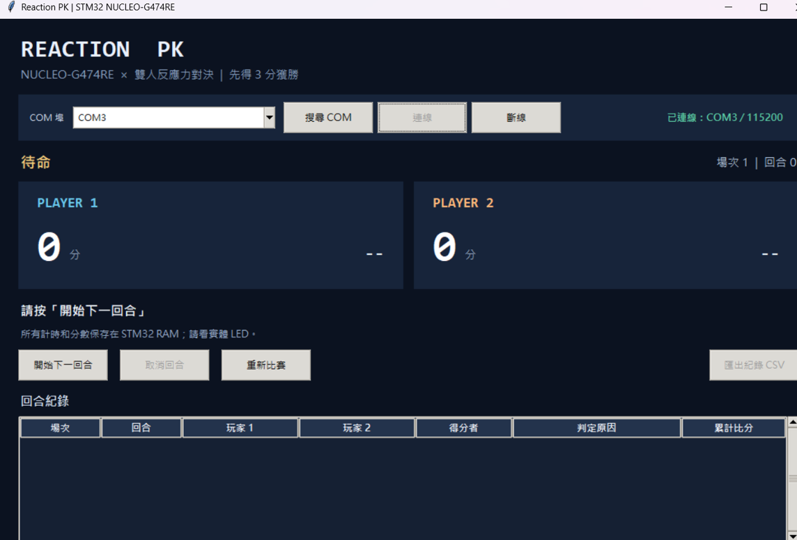
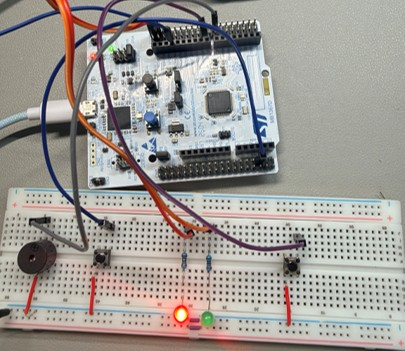
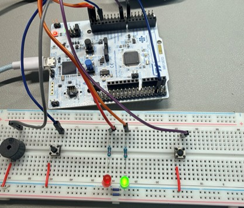

# NUCLEO-G474RE 雙人反應力 PK 遊戲＋Python 圖形客戶端

**版本：UART 協定 v1｜STM32 HAL、LPUART1、Tkinter＋pySerial｜有源蜂鳴器 GPIO 版**

這份壓縮檔是**加入既有 STM32CubeIDE／STM32G474RE HAL 專案的程式套件**，不是可直接開啟的完整 CubeIDE 工程。不包含 `.ioc`、CMSIS、STM32 HAL Drivers、啟動碼、linker script 或 STM32CubeIDE 專案設定。必須先有能以 ST-LINK 燒錄、HAL SysTick 正常運作的 NUCLEO-G474RE 專案，再依第 2 節整合。

**教授驗收補充：** [`MAIN_C_教授口頭講解.md`](MAIN_C_教授口頭講解.md) 說明 `main.c` 各函式與七項技能對照；[`GITHUB_公開上傳教學.md`](GITHUB_公開上傳教學.md) 提供公開儲存庫上傳流程。本套件 **未實作 PWM 與按鈕 EXTI 中斷**，請依真實狀態向教授說明。

系統使用同一顆 PC8 綠燈當作雙方起跑訊號。**STM32 負責去彈跳、隨機等待、毫秒計時、勝負與比分；Python 只做控制、顯示和匯出**。玩家卡片、回合紀錄、CSV 的反應時間採 `0.237 秒` 格式，UART 永遠傳原始整數毫秒 `237`。

## 專題實作照片

以下為本專題的 **Python 圖形客戶端畫面** 與 **NUCLEO-G474RE 實體接線照片**，方便教授在 GitHub README 直接查看，無須另外下載圖片。照片由專題製作者提供。

### Python 操作介面（COM3 連線畫面）

圖片3.png

畫面展示 Tkinter 客戶端的 COM 埠選擇與已連線資訊、兩位玩家比分區、開始／取消回合、重新比賽與回合紀錄欄位。**此截圖為待命畫面，不代表已展示完整對戰結果。**

### STM32 實體接線：紅燈亮起



可見 NUCLEO-G474RE、麵包板、兩顆玩家按鈕、紅／綠 LED、限流電阻與蜂鳴器等硬體配置；這張照片中的紅色 LED 亮起，可作為等待燈號的展示照片。

### STM32 實體接線：綠燈亮起
圖片1.jpg


相同硬體配置下可見綠色 LED 亮起，可作為共用起跑燈號的展示照片。遊戲中兩名玩家應以這顆**實體綠燈**為反應時間起點，而不是看 Python 畫面上的提示。

> **驗證說明：** 這些照片呈現專題 GUI 與實體接線／燈號狀態，但無法單靠照片證明所有規則、時間精度或韌體已完整通過實機測試。完整驗證狀態詳見下方「測試方式與實際驗證狀態」。

## 0. 檔案清單

```text
ReactionPK_STM32_Python/
├─ firmware/
│  ├─ main.c              // HAL 啟動、GPIO、LPUART1、非阻塞收發與主迴圈
│  ├─ pk_game.c           // 不依賴 HAL 的遊戲狀態機、去彈跳、結算與 JSON
│  └─ pk_game.h           // 狀態機介面
├─ client/
│  ├─ pk_client.py        // Tkinter GUI 與序列埠背景執行緒
│  ├─ protocol.py         // JSON/LF 封包檢查、分段接收與壞資料復原
│  ├─ requirements.txt    // pySerial
│  └─ start_windows.bat   // Windows 一鍵開啟 GUI（需先安裝 Python 依賴）
├─ docs/
│  ├─ images/             // 專題實作照片（Python 介面、紅燈、綠燈）
│  ├─ overview_slide.png   // 專題總流程圖
│  ├─ main_flow.png        // main.c 主迴圈流程圖
│  └─ game_flow.png        // pk_game.c 判定流程圖（另附 SVG、DOT）
├─ tests/
│  ├─ pk_game_host.c      // 用 GCC 在電腦端模擬 STM32 狀態機
│  └─ test_client.py      // Python 協定測試及 C/JSON 交叉解析
├─ MAIN_C_教授口頭講解.md
├─ GITHUB_公開上傳教學.md
├─ .gitignore
└─ README.md
```

## 1. 硬體接線與 CubeMX 腳位設定

| 用途 | MCU 腳位 | CubeMX 設定 | 接線方式 |
|---|---|---|---|
| 玩家 1 按鈕 | **PB0** | GPIO_Input／Pull-up | PB0 → 常開按鈕 → GND |
| 玩家 2 按鈕 | **PC7** | GPIO_Input／Pull-up | PC7 → 常開按鈕 → GND |
| 共同起跑綠燈 | **PC8** | GPIO_Output／Push Pull／No pull／Low speed／初始 Low | PC8 → 330 Ω → LED 正極；LED 負極 → GND |
| 等待紅燈（選配） | **PC6** | 同綠燈 | PC6 → 330 Ω → 紅色 LED 正極；負極 → GND |
| 有源蜂鳴器控制 | **PB1** | GPIO_Output／Push Pull／No pull／Low speed／初始 Low | PB1 → 1 kΩ → NPN 電晶體 B 極（詳見下節） |
| ST-LINK VCP TX | **PA2** | **LPUART1_TX** | 使用板上 ST-LINK VCP 路徑 |
| ST-LINK VCP RX | **PA3** | **LPUART1_RX** | 使用板上 ST-LINK VCP 路徑 |

> **按鈕低電位有效**：放開讀到 High，按下接 GND 讀到 Low，兩顆皆用**內部上拉**，不可設為內部下拉。四腳輕觸開關的同側兩腳可能本來就導通，必須確認跨邊接線。PB0/PC7 是 MCU 腳位代號，不是排針腳號。

綠燈只有一顆，兩個人都看這顆實體 PC8 LED；PC6 紅燈是等待提示，不影響運作。LED **不是** NUCLEO 板上的 LD2。限流電阻視 LED 額定值調整，請勿直接把 LED 接上 GPIO。

### 1.1 兩腳有源蜂鳴器外部驅動

此版 **PB1 High＝啟動、Low＝停止**，不使用 PWM／TIM3。對於未知負載電流的兩腳有源蜂鳴器，**不要直接接在 PB1**，使用低側 NPN 電晶體驅動：

| 元件接點 | 連接 |
|---|---|
| PB1 | 經 **1 kΩ** 電阻接電晶體基極 B |
| NPN 射極 E | GND |
| NPN 集極 C | 有源蜂鳴器負極 − |
| 蜂鳴器正極 ＋ | 額定供電 **V_BZ**（依實際蜂鳴器規格，不能猜是 3.3 V 還是 5 V） |
| 10 kΩ 電阻 | NPN B 與 E 之間，讓控制端不會上電浮動 |
| 續流二極體（磁性／感性負載） | 並聯蜂鳴器，**有色環陰極接正極**，陽極接負極，額定值應足夠 |
| 電源共地 | 蜂鳴器電源負端、電晶體 E、NUCLEO GND 全部共地 |

可考慮 2N2222、S8050 類 NPN，**E/B/C 排列一定依實際元件 datasheet 確認**；1 kΩ 是常見小電流起點，需依負載電流、電晶體能力選擇。若是三腳 IN/VCC/GND 模組，只有在接受 3.3 V 邏輯且**高電位觸發**時，才可讓 PB1 連到 IN；低電位觸發模組不適用這份程式與初始輸出設定。不確定蜂鳴器額定電壓時，先不接蜂鳴器電源，仍可測試 LED、按鈕與通訊。

## 2. STM32CubeIDE 專案整合（必要）

### 2.1 先在 CubeMX／`.ioc` 完成

1. 使用 STM32CubeIDE 建立/開啟**NUCLEO-G474RE（STM32G474RE）HAL** 專案，先備份 `Core/Src/main.c`。
2. 在 Pinout 設定第 1 節的 PB0、PC7、PC8、PC6、PB1，按鈕為 Pull-up、輸出初始 Low。
3. 在 `Connectivity → LPUART1` 選 **Asynchronous**、TX/RX、115200 Baud、**8 Data Bits、No parity、1 Stop Bit、Hardware Flow Control None**；**不要選 RS485**。PA2／PA3 選 LPUART1 對應 Alternative Function。
4. `SYS → Debug` 選 **Serial Wire**。不使用 TIM3、PWM、DMA、UART RX 中斷。若舊專案用 PB1/TIM3 PWM，先停用 TIM3 Channel 4 並把 PB1 改成 GPIO_Output。
5. RCC／Clock Configuration：本套 `main.c` 提供 **HSI16／PLL 170 MHz** 參考設定（PLL M=4、N=85、R=2；SYSCLK 170 MHz）。需保證板上電源／FLASH latency 與 1 ms HAL tick 正常。如原專案採其他時鐘，請調整 `SystemClock_Config()`，但維持 HAL tick 1 ms，並確保 LPUART1 的有效 kernel clock 能形成 115200 Baud。
6. 執行 **Project → Generate Code**。保留產生的 `Core/Inc/main.h`、`Core/Src/stm32g4xx_hal_msp.c`、`stm32g4xx_it.c`、`system_stm32g4xx.c`、HAL configuration/driver、startup、linker script。**HAL_UART_MspInit 必須真的啟用 LPUART1 週邊時鐘，以及 PA2／PA3 GPIO AF 與時鐘。** 如果選錯 UART/AF，即使 C 程式成功編譯，電腦也收不到回應。
7. 確認 `SysTick_Handler()` 最終會呼叫 `HAL_IncTick()`；不要停掉 SysTick 或把 HAL tick 當成微秒刻度。

### 2.2 放置檔案

| 本壓縮檔 | 複製到 CubeIDE 專案 |
|---|---|
| `firmware/main.c` | `Core/Src/main.c`（**覆蓋前先備份**） |
| `firmware/pk_game.c` | `Core/Src/pk_game.c` |
| `firmware/pk_game.h` | `Core/Inc/pk_game.h` |

請勿把 `tests/pk_game_host.c` 放進 STM32 專案，也不要同時留下兩份各有 `main()` 的 C 檔。貼入後 **Refresh → Clean/Build → ST-LINK Download/Run**。若出現 `pk_game.h: No such file or directory`，確認路徑為 `Core/Inc`；若是 `undefined reference to PK_Update`，檢查 `pk_game.c` 真的有加入編譯。

`main.c` 完整包含 HAL 初始化呼叫、GPIO、LPUART1、170 MHz 參考時鐘與 UART 非阻塞輪詢；但**仍依賴既有 CubeIDE 產生的周邊支援檔**，絕不是獨立可編的完整晶片工程。如果再次 Generate Code，CubeMX 可能覆寫 `main.c`，請重新比對/放回本套內容。CubeMX 產生的 `main.h` 不需手寫本套腳位巨集，因本套直接使用 `GPIO_PIN_x`。

### 2.3 執行機制與精度

- `main.c` 主迴圈先讀 UART **最多一個 RX byte**、送出環形緩衝 **最多一個 TX byte**，隨即取 GPIO 狀態更新遊戲，避免 UART 長訊息阻塞按鈕偵測。
- UART TX 使用 2048 byte 環形緩衝；空間不足時**整包捨棄**，不傳破損半包。背景狀態查詢會恢復畫面。RX 最長 31 個可列印 ASCII 字元（指令很短），過長/錯誤/overrun 指令會捨棄到下一個 LF。
- C 遊戲邏輯以 `HAL_GetTick()` 的 **1 ms** 無號差值運作，支援 32-bit tick 回繞。LED 亮起時間由 STM32 記錄，不使用 PC 的 USB 送達時間。
- 主迴圈**不呼叫 `HAL_Delay()`、`HAL_MAX_DELAY`、阻塞式 UART 收發**，也不啟動 UART RX IRQ/DMA。請勿再加入其他長阻塞工作。
- 正常 `OK` 判定蜂鳴器短響 **100 ms**；平手、搶按、逾時、取消等其他結算長響 **450 ms**。由主迴圈到時關閉 PB1，不使用 PWM。
- 這是毫秒級教學實作；GPIO 輪詢與 SysTick 排程仍會有些許誤差，**不是微秒精度，也不是校準過的專業計時設備**。

## 3. Python 安裝與啟動（Windows）

1. 安裝 [Python 3.10 或更新版本](https://www.python.org/downloads/)，含 Tcl/Tk 與 pip。可在終端機執行 `py -m tkinter` 確認 GUI 支援。
2. 解壓縮 ZIP。用 PowerShell 或命令提示字元進入 `client` 資料夾，執行：

   ```powershell
   py -m pip install -r requirements.txt
   py pk_client.py
   ```

   若系統沒有 `py` 啟動器，改用：

   ```powershell
   python -m pip install -r requirements.txt
   python pk_client.py
   ```

3. 安裝相依套件後，也可以雙擊 `client/start_windows.bat`；`pk_client.py` 與 `protocol.py` 必須維持在同個資料夾。
4. GUI 用 Tkinter，通常隨 Windows 官方 Python 安裝，不須另用 pip 安裝。若出現 `ModuleNotFoundError: serial`，執行上述 pip 指令；此處套件名為 `pyserial`，不是 `serial`。

## 4. 遊戲操作

1. 用可傳輸資料的 USB 線將 NUCLEO 板 ST-LINK 接到 Windows，確認 Device Manager 有 **ST-LINK Virtual COM Port**。先關掉可能佔住 COM 的 SerialAssistant／其他串列監視器。
2. 開啟 GUI，按「**搜尋 COM**」，選正確的 COM 埠，再按「**連線**」。GUI 會送 `HELLO` 和 `STATUS` 讀取板上現有狀態。
3. 按「**開始下一回合**」。進入 ARM 後兩人都要放開按鈕，穩定釋放 20 ms 才進入 WAIT；10 秒仍未準備好，自動取消、不加分。
4. WAIT：PC6 紅燈（若有安裝）亮起，隨機等 **2～5 秒**；**此時按下是搶按**。GO：共同 PC8 綠燈亮後，兩人按自己的實體按鈕。
5. STM32 等兩人完成或 5 秒期限，結算後 GUI 顯示回合反應時間、得分者、累計比分與原因。反應時間顯示三位小數，例如 **237 ms → 0.237 秒**。
6. 按「開始下一回合」繼續，**先拿 3 分**的玩家贏整場；完成後用「重新比賽」送 `NEW`，清空板上比分，場次編號加一。
7. 「**取消回合**」可在 ARM／WAIT／GO 使用，不加分；「**匯出紀錄 CSV**」可將目前客戶端已接收到的已結算回合存成 UTF-8 with BOM（Excel 可讀）。

**注意：螢幕上「綠燈已亮」顯示經 UART 和 GUI 更新，可能晚於實體燈。一定要看實體 PC8 LED 反應，不可用 GUI 字樣當起跑訊號。**

## 5. 判定細則（STM32 單獨完成）

| 事件 | 判定與加分 | UART `reason` |
|---|---|---|
| 兩人都有有效反應時間且不同 | 毫秒較小者 +1 | `OK` |
| 兩人同毫秒 | 平手，不加分 | `TIE` |
| 玩家 1 搶按 | 玩家 2 +1 | `P1_EARLY` |
| 玩家 2 搶按 | 玩家 1 +1 | `P2_EARLY` |
| 兩人搶按（首位確認後 20 ms 窗口內，第二人也確認） | 不加分 | `BOTH_EARLY` |
| 玩家 1 逾時、玩家 2 有效 | 玩家 2 +1 | `P1_TIMEOUT` |
| 玩家 2 逾時、玩家 1 有效 | 玩家 1 +1 | `P2_TIMEOUT` |
| 兩人皆逾時 | 不加分 | `BOTH_TIMEOUT` |
| ARM 等候放開按鈕 10 秒仍未完成 | 取消此回合，不加分 | `NOT_READY` |
| 客戶端在 ARM／WAIT／GO 取消 | 取消此回合，不加分 | `CANCELLED` |

- 按鈕去彈跳：**連續穩定低電位達 20 ms** 才確認為按下事件。反應成績回溯到這段低電位的**起點**，不直接加上 20 ms；短於 20 ms 的按壓可能被濾除。
- STM32 在 WAIT 偵測到第一位已確認搶按時，**不點綠燈**，再讓另一位有 **20 ms 確認窗口**。窗口內第二人也確認即為 `BOTH_EARLY`。等待切 GO 時如果有**尚未完成 20 ms 確認的按下候選狀態**，也不會點綠燈。
- 反應的有效起點落在綠燈亮後 **0～4999 ms** 才有效；在第 4999 ms 開始並通過 20 ms 穩定確認的按壓仍有效，STM32 最多額外等待此確認窗口再結算。開始於 5000 ms 或更晚的按壓算逾時。
- 第一人有效按下後還要等第二人，**不會先按先立即結束回合**。平手、雙方搶按、雙方逾時、取消不加分，總回合數可能超過五回合。
- 累計比分只存在板上 RAM，最大到 3；電腦只是顯示。板子重置/斷電會重置到 **場次 1、回合 0、0:0**。

## 6. UART v1 通訊協定（兩端一致）

固定 **LPUART1：115200 Baud，8N1，ASCII，LF (`\n`) 結尾**。STM32 接受 CRLF (`\r\n`) 指令。每個指令**單獨一行**，不可加空白或多餘引號：

| Python → STM32 | 用途／接受時機 |
|---|---|
| `HELLO` | 回覆完整 `event=HELLO` 快照，任意階段可查 |
| `STATUS` | 回覆完整 `event=STATUS` 快照，任意階段可查 |
| `START` | 僅 IDLE／RESULT 接受，開始下一回合、`round+1`，送 `event=ARM`；DONE 需先 NEW |
| `NEW` | 僅 IDLE／RESULT／DONE 接受，分數歸零、`match+1`、`round=0`，送 `event=NEW` |
| `CANCEL` | 僅 ARM／WAIT／GO 接受，送 `event=RESULT`、`reason=CANCELLED`，不計分 |

STM32 每次傳一行**完整 JSON**，**每行都有相同的 12 個欄位**。例如：

```json
{"v":1,"event":"RESULT","match":1,"round":1,"phase":"RESULT","p1_ms":237,"p2_ms":281,"s1":1,"s2":0,"target":3,"winner":1,"reason":"OK"}
```

| 欄位 | 型別、值域及意思 |
|---|---|
| `v` | 整數，固定 `1` |
| `event` | `HELLO`／`STATUS`／`NEW`／`ARM`／`WAIT`／`GO`／`RESULT`／`ERROR` |
| `match` | 目前場次編號，從 `1` 起，NEW 加 1 |
| `round` | 目前場次內的回合編號，從 `0` 起，START 加 1 |
| `phase` | `IDLE → ARM → WAIT → GO → RESULT`，達 3 分時直接為 `DONE`（`event` 仍是 `RESULT`） |
| `p1_ms`, `p2_ms` | 各玩家有效反應時間（整數 `0～4999` 毫秒），`-1` 代表尚無有效成績 |
| `s1`, `s2` | 玩家累計得分（`0～3`） |
| `target` | 勝利門檻，固定 `3` |
| `winner` | **本回合得分者**，`0` = 沒有人加分，`1` = 玩家 1，`2` = 玩家 2；整場勝者在 DONE 由達 3 分的一方判定 |
| `reason` | 本回合判定、等待狀態 `NONE`，或錯誤代碼 |

`ERROR` 回覆也包含上述欄位，`reason` 是 `BUSY`（進行中不能 START/NEW）、`MATCH_DONE`（DONE 不能 START）、`NOT_ACTIVE`（沒有回合可 CANCEL）或 `BAD_COMMAND`（無效指令）。錯誤回覆不會修改遊戲比分或真正的比賽階段。

**分段與壞資料復原：** STM32 UART RX 緩衝指令，分段接收直到 LF 才執行；超長行、非法 ASCII 與 overrun 都丟棄到 LF，不把殘缺的指令當成有效命令。Python `LineDecoder` 接受任意分塊、一次讀到多行及 CRLF；JSON 壞包、過長包、錯誤 v/欄位會被捨棄，直到下一行重新同步。UART 超時可能丟棄單次狀態通知，但下一次 STATUS 可讀回板上真實狀態。

## 7. 斷線、重連及紀錄限制

- Python 的 serial reader/writer 是**背景執行緒**，透過 thread-safe `queue.Queue` 交付 GUI；只在 Tkinter **主執行緒**呼叫更新元件。序列埠開啟、讀取、寫入都有短逾時，不阻塞視窗。
- 開始連線送 `HELLO`＋`STATUS`，接收**任一合法**完整快照才顯示已連線。之後每 **2 秒**送 `STATUS`；若連續 **6 秒**未收到合法快照，提示錯誤並視為斷線。
- STM32 在 RAM 保留**目前比分、場次、回合、最近結果**。重連後 `HELLO`／`STATUS` 可以恢復這些資訊；板子**沒有保存全部歷史**，也沒有 Flash/EEPROM 持久化。
- 每次成功新連線後，GUI **清除前次連線的表格歷史**，用板上當前/最近的 RESULT 或 DONE 快照重建最多一筆，避免和板子重置後的新紀錄混淆。**要保存完整歷史，先匯出 CSV。**
- 在同一次連線期間按 `NEW`，GUI 不清空已經收到的歷史，而是利用 `match` 欄位區分場次。
- **斷線不會自動取消板上回合**；若要取消，必須在還有連線時送 `CANCEL` 並看到結果。Python 關閉不保證已送出取消指令。

## 8. 常見問題排除

| 現象 | 建議檢查 |
|---|---|
| 完全沒有 COM 埠 | 檢查 USB 是否為資料線、ST-LINK 驅動、裝置管理員、Windows USB 權限 |
| COM 埠被占用 | 關閉 SerialAssistant、Arduino Serial Monitor 或第二個 GUI，再重新連線 |
| 顯示 6 秒無合法回應 | 確認燒錄本版、LPUART1 **不是 USART2**、PA2／PA3 AF、MSP 啟用 LPUART1 時鐘、115200/8N1、板子未卡在 Error_Handler |
| 連線有字串但 GUI 不接受 | 應為**每行 ASCII JSON＋LF**、v=1、12 個欄位完整；不要混入 `printf` 除錯文字 |
| 一直停在「請兩人放開」 | PB0／PC7 是否正確 GPIO_Input＋Pull-up、放開高／按下低；四腳按鈕是否接錯同側常導通腳 |
| 按了卻無反應或誤判搶按 | 檢查共地/接點雜訊、按住至少 20 ms；注意等待階段是禁止搶按的 |
| 綠燈沒亮 | 檢查**外接 PC8** LED、LED 極性、330 Ω、GND，板載 LD2 不等於 PC8 |
| 蜂鳴器不響或一直響 | PB1 必須 GPIO_Output、低電位停止；檢查有源型號、NPN E/B/C 與限流、額定電壓和共地；不可沿用低觸發模組接線 |
| `pk_game.h` 找不到或連結失敗 | `Core/Inc/pk_game.h`、`Core/Src/pk_game.c`，不要被 Exclude from Build |
| HAL 編譯出錯／沒有 `SysTick` | 專案 MCU 選型、HAL Driver 版本、生成碼與 `main.c` 是否相容；`stm32g4xx_it.c` 應保留 `HAL_IncTick()` |
| `No module named serial` | 在 `client` 執行 `py -m pip install -r requirements.txt` |
| CSV 只有最近一回合 | 是否中途斷線重新連線？新連線的表格會重建，舊紀錄需斷線前先匯出 |

## 9. 測試方式與實際驗證狀態

在解壓後的**套件根目錄**（含 `tests/`）執行：

```powershell
python tests/test_client.py
```

若系統有 GCC，測試會在電腦上編譯 `pk_game.c` ＋ `tests/pk_game_host.c`、以模擬 GPIO 與毫秒時鐘驅動真實 C 狀態機，並用 Python 解析 C 輸出的 JSON。涵蓋正常反應、先拿三分、平手、單方/雙方搶按、單方/雙方逾時、4999 ms 邊界、10 秒未放開、取消、BUSY/BAD_COMMAND、32-bit tick 回繞以及跨位元組分段/壞包恢復。沒有 GCC 時，僅執行純 Python 測試，GCC 測試會略過。

**本包製作時在提供的電腦環境通過 6 項測試（其中包含主機 GCC 編譯 C 引擎與大量 JSON 交叉解析）。未在 NUCLEO-G474RE 實體板上進行 CubeIDE ARM 編譯、ST-LINK 燒錄、GPIO/蜂鳴器接線測試；亦未在 Windows 桌面實際操作 Tkinter GUI。** 不應把主機測試誤當成實體板驗證。

實體板初次驗證建議順序：HAL tick 與串口握手 → PB0/PC7 釋放/按下是否正確 → 紅燈/綠燈 → 正常雙人回合 → 搶按/平手/逾時 → 先得 3 分 → 取消/NEW → 拔掉客戶端再重連讀回比分。

## 10. 官方參考資料

- [ST NUCLEO-G474RE／UM2505](https://www.st.com/resource/en/user_manual/um2505-stm32g4-nucleo64-boards-mb1367-stmicroelectronics.pdf)
- [STM32G4 HAL UART header](https://github.com/STMicroelectronics/stm32g4xx-hal-driver/blob/master/Inc/stm32g4xx_hal_uart.h)
- [pySerial API](https://pyserial.readthedocs.io/en/latest/pyserial_api.html)
- [Python Tkinter](https://docs.python.org/3/library/tkinter.html)
